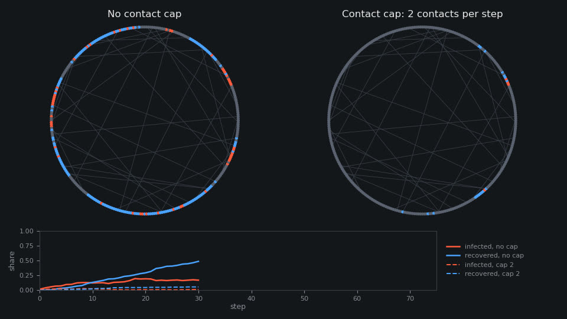

# Social distancing on networks: does a contact cap stop an SIR epidemic?

A Monte Carlo SIR epidemic simulator in Rust, used to test one question: if
every person may only have a limited number of contacts, does the epidemic
still spread? The cap is tried in two ways on generated networks
(Erdős–Rényi, Barabási–Albert, Watts–Strogatz, configuration model): once
with fixed contacts, where the network is thinned so nobody keeps more than
N edges (optionally with a share of people who ignore the cap), and once
with changing contacts, where the network stays whole but each person meets
only N randomly chosen neighbours per step. The experiment measures the
epidemic's peak, when it peaks, how long it lasts and how many people are
never infected, for caps from 1 to 19. Final project of the course Complex
Networks at UPC Barcelona, spring 2024.



*One Watts–Strogatz network (300 nodes) drawn as a ring, β = μ = 0.1. Left:
no cap; right: at most 2 contacts per person and step. Red is infected,
blue recovered; below, the infected and recovered shares of both runs.*

## What's where

- `network-sir/` (Rust): the SIR simulator. It keeps each node's count of
  infected neighbours up to date as nodes change state, so a step doesn't
  rescan the neighbourhoods, and runs the repetitions on a thread pool.
  `debug_assert!`s in `sir.rs` check the S/I/R totals against a recount in
  debug builds.
- `graph-sd-adaptor/` (Rust): thins a network to a maximum degree
  (`max_degree`), or does so for all but a given share of nodes (`cheat`).
- `network_gen/` (Rust and Python): network generators; networks are stored
  as Pajek `.net` files.
- `run.py`, `gen_graphs.py`, `analyze_sir_results.py`: the experiment
  runner, the network set and the analysis with matplotlib plots.

## How to run

Needs stable Rust and Python 3 with numpy, matplotlib and networkx. Run from
the repository root; `run.py` builds the Rust crates itself with
`cargo build --release`.

```sh
python3 run.py gen                        # generate the networks into graphs/
mkdir -p graphs_single graphs-sd-single-no-adapt
cp "$(ls graphs/basic/*/*.net | head -1)" graphs_single/  # one network for the "single" runs
python3 run.py copy_single adapt sim_all analyze
```

The plots land in `plots/`, the summary table in `results_summary.txt`. The
power-law configuration model can't be generated for every random seed
("could not generate configuration model"); those networks are then missing
and the rest runs on the ones that were made. The network set is
chosen in `gen_graphs.py` (`sim_tasks`); β, μ and the share of initially
infected nodes are at the top of `run.py`. `python3 run.py cheat_prop_expr
cheat_prop_ana` runs the variant in which a share of people ignore the cap.

This is course code: the runner calls the binaries through `os.system` and
the simulator's thread count is fixed in `network-sir/src/main.rs`.

## Credits

Course: Complex Networks, UPC Barcelona (2024). Final project, done as a
team; John Kelly Villota Pismag contributed `network_gen/caveman_graph.py`.
The Python Erdős–Rényi and Barabási–Albert generators in `network_gen/` are
by Jordi Canosa Casellas, from an earlier assignment of the course.

Licence: MIT, see `LICENSE`.
